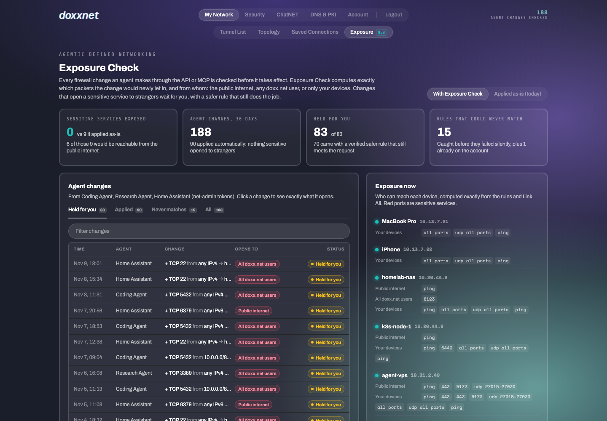

# Exposure Check for doxx.net (concept demo)

**Live demo:** https://mohith26.github.io/doxx-exposure-check/

> Unofficial concept demo by Mohith Gajjela. Not affiliated with doxx.net. Synthetic account and change log; all addresses are documentation ranges (RFC 5737, RFC 3849). Defensive feature only.



## The pitch

doxx.net lets AI agents run your network: with a net-admin token an agent can add firewall rules, toggle Link All and lease addresses through the API or MCP, and "firewall changes take effect immediately on active connections" ([config.doxx.net](https://config.doxx.net)). The same "allow port 22" means three different things depending on the address: a tunnel's IPv4 is internal to doxx.net, its IPv6 is public, and a dedicated IPv4 is public ([Firewall help](https://www.doxx.net/help/features/connectivity-and-routing/firewall/)). The API docs also warn that a rule pinned to the wrong source "fails silently". **Exposure Check** sits in front of every agent change: it computes *exactly* which packets the change would newly let in and from whom (the public internet, any doxx.net user, or only your devices), applies safe changes instantly, holds the ones that open a sensitive service to strangers, and offers a safer rule that still does what the user asked, verified exactly.

## Results (synthetic account, 30 days, numbers from `data/results.json`)

One Pro account with 6 tunnels and 3 agents (Coding Agent, Research Agent, Home Assistant), 188 agent-proposed firewall changes:

| | Applied as-is (today) | With Exposure Check |
|---|---|---|
| Sensitive services exposed at the end of the month | **9** (6 to the public internet, 3 to every doxx.net user: SSH, Redis, Grafana/dev server, Jenkins, PostgreSQL, RDP) | **0** |
| Changes applied without a person | 188 | 90 (nothing sensitive opened to strangers) |
| Changes held for the owner | 0 | 83, of which **70 came with a verified safer rule** that still meets the request; 13 need a person because the request itself needs outside access |
| Rules that could never match (would fail silently) | applied | **15 caught** (plus 1 already on the account, and 1 redundant rule) |

## How it works

All of it is `src/exposure.js` (no dependencies; the page and the tests run the same code).

1. **Packet space.** A packet is a point (destination endpoint, source address, protocol, destination port, source port). Each tunnel contributes up to three endpoints: internal IPv4 (reachable only from doxx.net tunnel space), public IPv6, and a dedicated public IPv4.
2. **Rules are boxes.** Each doxx.net allow rule (`protocol`, `src_ip` CIDR, `dst_ip`, ports) is an axis-aligned box, clipped to what can physically arrive at that endpoint. Link All adds boxes between the account's own tunnels. A rule set is kept as a list of pairwise-disjoint boxes, so **union, difference, intersection, emptiness, subset and exact counting** are all exact (header space analysis, Kazemian et al. 2012; the same idea as AWS Zelkova).
3. **Diff.** `opened = after \ before`, split by source class (your devices / other doxx.net users / internet). Every verdict comes with a concrete witness packet (`TCP 10.99.1.7:51514 → 10.20.44.8:22: before dropped, after accepted`).
4. **Guardrail.** A forbidden region: sensitive services (SSH, RDP, SMB, databases, Docker/Kubernetes APIs, admin HTTP, ...) reachable from anyone who is not you. A change is held iff `opened ∩ forbidden ≠ ∅`. CISA KEV counts per service (`data/kev_ports.json`, catalog 2026.11.10) are shown as evidence, not used as weights.
5. **Safer alternative.** For a held change with a stated intent ("from my laptop"), it synthesises rules from the intended devices' internal /32s to the destination's internal IPv4, then proves `intent ⊆ allowed(after)` and `opened ∩ forbidden = ∅` before offering it.
6. **Rule health.** A rule whose box is empty after clipping can never match (for example a public source pinned to an internal address); a rule whose box is covered by the others is redundant.

## The app

A rebuild of the doxx.net portal (a0x13.doxx.net), dark theme, with the feature under **My Network > Exposure**:

- **Exposure view:** stat tiles, a with/without comparison switch, the agent change log (tabs Held for you / Applied / Never matches / All, filter), the exact exposure map per tunnel, and rule health with Remove.
- **Change review panel:** the guardrail verdict, the proposed rule, exactly what it newly lets in by audience, an example packet, the verified safer rule, and Reject / Approve as proposed / Apply safer rule (decisions persist in `localStorage` and the whole month is re-simulated).
- **Firewall Configuration panel** (Tunnel List > Firewall): the production layout (Enable Firewall Protection, Inbound Allows presets, + Add Custom Rule, Custom Rules / Tunnel Links, rules table) with a live exposure preview while you type a rule.
- Deep links (`#/ops/tunnels/exposure?tab=held&change=1186`, `#/ops/tunnels?fw=nas`), keyboard (`j`/`k`, `Enter`, `Esc`, `/`, `e`), loading and error states, export (JSON report and CSV of every change).
- **Fidelity:** dark-theme tokens, capsule navigation (My Network, Security, ChatNET, DNS & PKI, Account; Tunnel List, Topology, Saved Connections), the ambient background fallback gradient, firewall-panel structure and copy, and the logotype come from the public portal bundle at a0x13.doxx.net. The brand typeface (Acumin Variable Concept) is licensed, so the demo uses Archivo as the closest open substitute; Share Tech Mono and Space Mono match.

## Run it

```
node scripts/generate.mjs        # regenerate data/account.json (seeded)
node scripts/report.mjs          # recompute data/results.json
node --test test/*.test.mjs      # 14 tests
python3 -m http.server           # open http://localhost:8000
```

Tests include a randomized property test that checks the symbolic allowed set against brute-force packet evaluation (10,000 packets over random rule sets, IPv4 and IPv6, Link All on and off), exact box subtraction and set identities, IPv4-internal vs IPv6-public semantics, dead and redundant rules, the guardrail witness, Link All, safer-alternative verification, rule deletion, the full replay (and that approving re-creates exposure while the safer rule does not), the headline numbers, and determinism. `ci/test.yml` is the GitHub Actions workflow (move it to `.github/workflows/` once the pushing token has the `workflow` scope).

## Honest limitations

- **Model of doxx.net semantics.** Built from the public API manifest and help pages: default-deny inbound allows, internal IPv4 reachable from the doxx.net network (per the Port Forwarding page), public IPv6 and dedicated IPv4. If doxx.net isolates customers from each other on internal IPv4, the "all doxx.net users" audience collapses to "your devices" and fewer changes are held. Port forwarding, proxies, VPS and host firewalls are not modelled.
- **Synthetic data.** The account, agents, requests and change mix are invented; the point is the method, which is exact for the rule language, not the counts.
- **Intent is given, not inferred.** The safer rule needs to know who should reach the service (here from the agent's request). Without that, Exposure Check still holds the change but cannot propose an alternative.
- **The guardrail list is a policy choice.** Sensitive ports are a default list; KEV counts are evidence that these services get exploited, not a risk score.
- **Brand typeface substituted** (licensed Acumin replaced by Archivo).

## Prior art and novelty

- Exact network policy verification is established: header space analysis (Kazemian, Varghese, McKeown 2012), Batfish, AWS Zelkova / IAM Access Analyzer, Azure Network Watcher "IP flow verify". These target cloud configs, run offline or on demand, and are not wired into an agent's write path.
- Mesh VPNs such as Tailscale offer ACL tests for human-written policy files; none found that checks each AI agent change, splits exposure by audience including an IPv4-internal / IPv6-public split, and returns a verified least-exposure alternative.
- doxx.net's API manifest documents RBAC roles, token expiry and a kill switch for agents, and warns about silent rule failures, but has no dry-run or exposure preview for firewall changes (checked config.doxx.net v1.1.0, the Firewall, Port Forwarding and API & MCP help pages, and the product pages).
